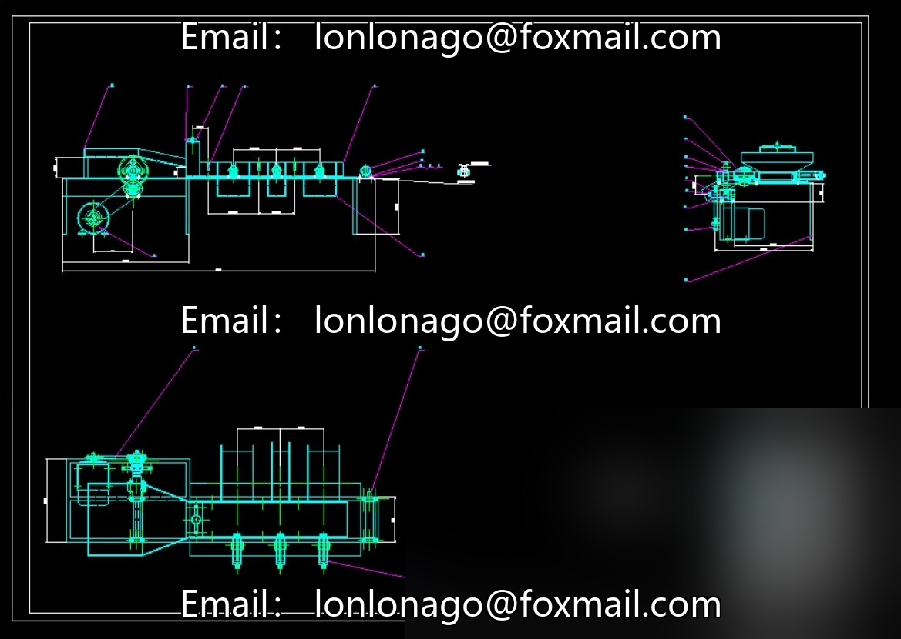
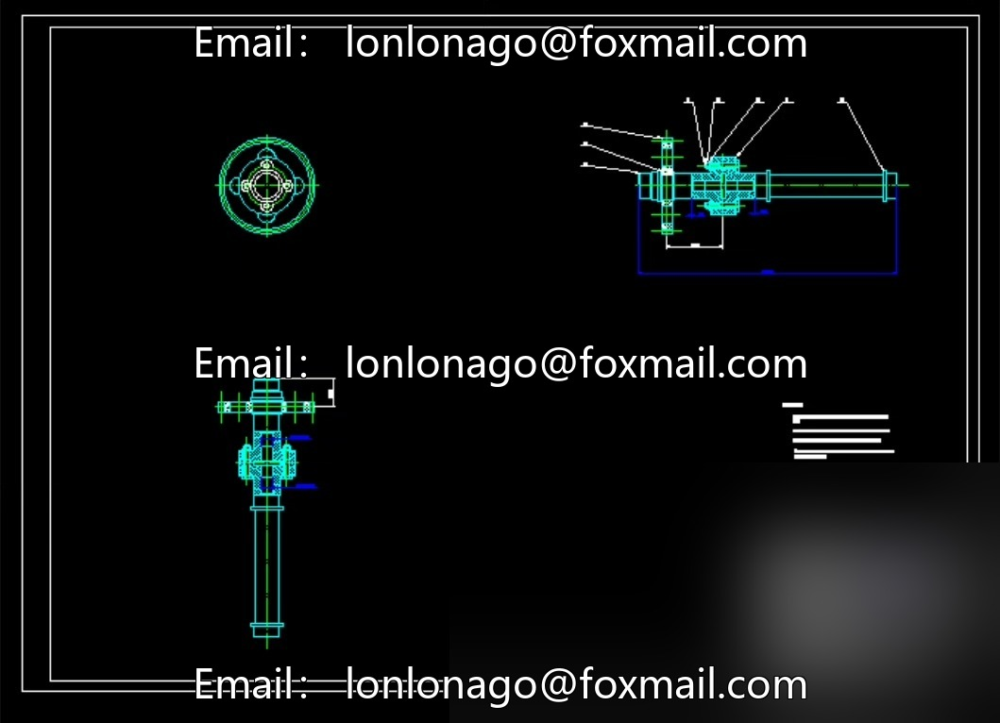
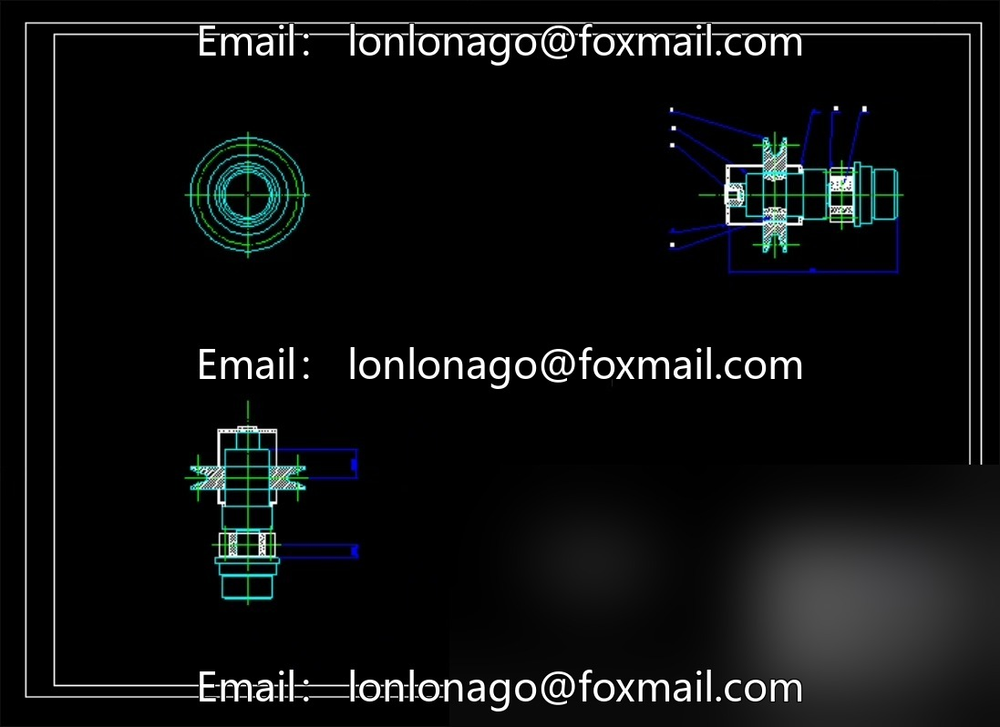

# Apple automatic sorting machine design, Apple automatic sorting machine figure, Apple automatic sorting machine design figure

## Body

Apple automatic sorting machine design, Apple automatic sorting machine diagram, Apple automatic sorting machine design diagram, Apple automatic sorting machine design CAD diagram
183 This design includes the design description, it is the mechanical system design of the Apple automatic sorting machine, and its main work contents include: selection of speed motor, design of belt pulley size and shape, design of sizes and key slots of various bearings, design of cylindrical open gear size and structural design as well as calculation and verification of various parameters such as speed and efficiency.

The content covers apple automatic sorting machine design, design drawings, and CAD drawings; it includes a mechanical system design description covering motor selection, V-belt wheel design, bearing and key slot design, gear structure, speed and efficiency calculations, and verification.

<!-- AI_ENRICHED -->

## Images

## Payment

Here is a pay link on Stripe ( https://buy.stripe.com/3cs8yP7sY87d0vu9AB ). Please contact me lonlonago@foxmail.com after funding $89, and I will send you a complete data files , thank you!

